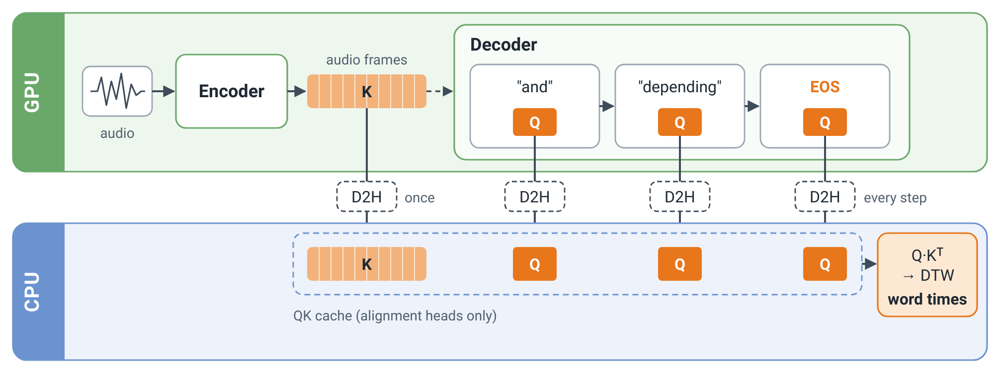

# Whisper word timestamps via QK offload (vLLM v0.32.0)

This is vLLM v0.32.0 plus word-level timestamps for Whisper. It keeps the fused
attention kernels, runs no second model and makes no second forward pass.

<p align="center">
  
</p>

## Context

Whisper's word timing comes from the cross-attention of a few "alignment
heads". Fused attention kernels never materialize attention probabilities, and
keeping full Q/K for every request on the GPU takes memory away from the KV
cache. This implementation:

1. **Captures only what is needed.** Each step, a CUDA-graph-safe custom op
   copies the alignment heads' queries, and on a request's first step the
   encoder keys, into one small static GPU staging buffer (12.6 MiB for
   large-v3-turbo).
2. **Offloads it.** The stage is copied to pinned host memory asynchronously,
   and a host thread files rows into per-request CPU buffers. No per-request
   state stays on the GPU.
3. **Reconstructs on the CPU** when a request finishes. It recomputes the
   alignment-head attention, then median-filters it and runs DTW, following
   OpenAI Whisper's `find_alignment`.
4. **Is opt-in per request.** Only requests that ask for word timestamps are
   captured and aligned.

Code:
- [`vllm/model_executor/models/whisper_word_timing.py`](vllm/model_executor/models/whisper_word_timing.py):
  capture op, reconstruction, word splitting.
- [`vllm/v1/worker/gpu/qk_offload.py`](vllm/v1/worker/gpu/qk_offload.py):
  offload and readout in the model runner.

## Install

```bash
VLLM_USE_PRECOMPILED=1 pip install -e .   # Python-only changes; reuses v0.32.0 kernels
```

## Use

The examples use vLLM's bundled sample clip, `mary_had_lamb` (16 s).

### Server

<details>
<summary>Example: start the server, send the sample clip, full response</summary>

```bash
vllm serve openai/whisper-large-v3-turbo --enable-word-timestamps

# Fetch the sample clip (or use any audio file).
cp "$(python -c 'from vllm.assets.audio import AudioAsset; print(AudioAsset("mary_had_lamb").get_local_path())')" .

curl localhost:8000/v1/audio/transcriptions \
  -F file=@mary_had_lamb.ogg -F model=openai/whisper-large-v3-turbo \
  -F response_format=verbose_json -F 'timestamp_granularities[]=word'
```

Output (reformatted to one word per line):

```json
{
  "duration": 15.948,
  "language": "en",
  "text": " The first words I spoke in the original phonograph, a little piece of practical poetry. Mary had a little lamb, its streets were quite as slow, and everywhere that Mary went, the lamb was sure to go.",
  "segments": [
    {"id": 0, "seek": 0, "start": 0.0, "end": 15.64, "temperature": 0.0,
     "avg_logprob": -0.20744268377229277, "compression_ratio": 1.3986013986013985, "no_speech_prob": null,
     "text": " The first words I spoke in the original phonograph, a little piece of practical poetry. Mary had a little lamb, its streets were quite as slow, and everywhere that Mary went, the lamb was sure to go.",
     "tokens": [440, 700, 2283, 286, 7179, 294, 264, 3380, 30754, 3108, 11, 257, 707, 2522, 295, 8496, 15155, 13, 6059, 632, 257, 707, 10097, 11, 1080, 8481, 645, 1596, 382, 2964, 11, 293, 5315, 300, 6059, 1437, 11, 264, 10097, 390, 988, 281, 352, 13]}
  ],
  "words": [
    {"word": "The", "start": 0.0, "end": 0.88},
    {"word": "first", "start": 0.88, "end": 1.6},
    {"word": "words", "start": 1.6, "end": 2.02},
    {"word": "I", "start": 2.02, "end": 2.26},
    {"word": "spoke", "start": 2.26, "end": 2.66},
    {"word": "in", "start": 2.66, "end": 2.84},
    {"word": "the", "start": 2.84, "end": 3.08},
    {"word": "original", "start": 3.08, "end": 4.32},
    {"word": "phonograph,", "start": 4.32, "end": 5.06},
    {"word": "a", "start": 5.48, "end": 6.06},
    {"word": "little", "start": 6.06, "end": 6.42},
    {"word": "piece", "start": 6.42, "end": 6.82},
    {"word": "of", "start": 6.82, "end": 7.04},
    {"word": "practical", "start": 7.04, "end": 7.56},
    {"word": "poetry.", "start": 7.56, "end": 8.24},
    {"word": "Mary", "start": 8.62, "end": 9.26},
    {"word": "had", "start": 9.26, "end": 9.52},
    {"word": "a", "start": 9.52, "end": 9.72},
    {"word": "little", "start": 9.72, "end": 9.88},
    {"word": "lamb,", "start": 9.88, "end": 10.3},
    {"word": "its", "start": 10.38, "end": 10.54},
    {"word": "streets", "start": 10.54, "end": 10.76},
    {"word": "were", "start": 10.76, "end": 11.02},
    {"word": "quite", "start": 11.02, "end": 11.28},
    {"word": "as", "start": 11.28, "end": 11.48},
    {"word": "slow,", "start": 11.48, "end": 11.84},
    {"word": "and", "start": 12.06, "end": 12.26},
    {"word": "everywhere", "start": 12.26, "end": 12.62},
    {"word": "that", "start": 12.62, "end": 13.02},
    {"word": "Mary", "start": 13.02, "end": 13.34},
    {"word": "went,", "start": 13.34, "end": 13.58},
    {"word": "the", "start": 13.7, "end": 13.82},
    {"word": "lamb", "start": 13.82, "end": 14.14},
    {"word": "was", "start": 14.14, "end": 14.36},
    {"word": "sure", "start": 14.36, "end": 14.6},
    {"word": "to", "start": 14.6, "end": 14.8},
    {"word": "go.", "start": 14.8, "end": 15.06}
  ]
}
```

</details>

Without `timestamp_granularities[]=word` the response has `"words": null` and
the request pays no alignment cost.

### Offline

<details>
<summary>Example: <code>examples/whisper_word_timestamps.py</code> and its output</summary>

[`examples/whisper_word_timestamps.py`](examples/whisper_word_timestamps.py):

```python
from vllm import LLM, SamplingParams
from vllm.assets.audio import AudioAsset
from vllm.model_executor.models.whisper_word_timing import split_words

llm = LLM(
    "openai/whisper-large-v3-turbo",
    enable_word_timestamps=True,
    limit_mm_per_prompt={"audio": 1},
)
prompt = {
    "encoder_prompt": {
        "prompt": "",
        "multi_modal_data": {"audio": AudioAsset("mary_had_lamb").audio_and_sample_rate},
    },
    "decoder_prompt": "<|startoftranscript|><|en|><|transcribe|><|notimestamps|>",
}
params = SamplingParams(
    temperature=0, max_tokens=440, extra_args={"word_timestamps": True}
)
out = llm.generate(prompt, params)[0].outputs[0]

tokenizer = llm.get_tokenizer()
print(out.text)
for word, start, end in split_words(
    tokenizer, list(out.token_ids), out.token_timestamps, tokenizer.eos_token_id
):
    print(f"{start:6.2f} {end:6.2f}  {word}")
```

Output:

```text
 The first words I spoke in the original phonograph, a little piece of practical poetry. Mary had a little lamb, its streets were quite as slow, and everywhere that Mary went the lamb was sure to go.
  0.00   0.88  The
  0.88   1.60  first
  1.60   2.02  words
  2.02   2.26  I
  2.26   2.66  spoke
  2.66   2.84  in
  2.84   3.08  the
  3.08   4.32  original
  4.32   5.06  phonograph,
  5.56   6.06  a
  6.06   6.42  little
  6.42   6.84  piece
  6.84   7.02  of
  7.02   7.54  practical
  7.54   8.26  poetry.
  8.64   9.30  Mary
  9.30   9.52  had
  9.52   9.72  a
  9.72   9.88  little
  9.88  10.30  lamb,
 10.36  10.54  its
 10.54  10.78  streets
 10.78  11.02  were
 11.02  11.28  quite
 11.28  11.48  as
 11.48  11.84  slow,
 12.06  12.26  and
 12.26  12.64  everywhere
 12.64  13.02  that
 13.02  13.34  Mary
 13.34  13.60  went
 13.60  13.82  the
 13.82  14.14  lamb
 14.14  14.36  was
 14.36  14.60  sure
 14.60  14.80  to
 14.80  15.06  go.
```

</details>

## Results

Offline throughput in requests/s on 512 short clips (median 5.8 s), with
`max_num_seqs=256`.

| Model          | Config                       | RTX 4090     | H800          |
|----------------|------------------------------|--------------|---------------|
| large-v3-turbo | Flag off                     | 56.2         | 105.7         |
|                | Flag on, no word requests    | 55.9 (−0.5%) | 102.2 (−3.3%) |
|                | All requests want words      | 52.9 (−5.9%) | 82.7 (−21.7%) |
| large-v3       | Flag off                     | —            | 98.6          |
|                | All requests want words      | —            | 70.7 (−28.3%) |

- **Memory:** the KV cache is the same size with the flag on or off. The only
  GPU cost is a fixed 12.6–40 MiB staging buffer.
- **Accuracy:** word timings match OpenAI Whisper's `find_alignment` on the
  same tokens. The median difference is 0 and the p95 is 40–60 ms, for both
  models.

## Tests

```bash
pytest tests/models/multimodal/generation/test_whisper_word_timing.py
```

## Limitations

- Tensor parallel size must be 1.
- Only the transcription endpoint is supported, not translation.
- Requests stopped by a stop string get no timestamps.
- Languages without spaces are split per character.

Built on [vLLM](https://github.com/vllm-project/vllm); the
upstream vLLM README is kept as [README_legacy.md](README_legacy.md). The idea
comes from [Reka Speech](https://reka.ai/news/reka-speech-high-throughput-speech-transcription-and-translation-model-with-timestamps)'s QK-cache design.
